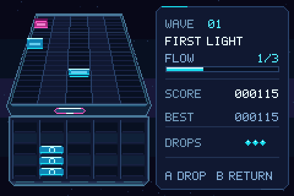

# Tile Flow Advance

[日本語](#日本語)

Tile Flow Advance is an arcade puzzle game for Game Boy Advance. Catch tiles as they roll down a five-lane belt, then drop them into a 5×5 grid. Match three or more tiles of the same color horizontally, vertically, or diagonally to clear them and reach each wave's goal.

Download `TileFlowAdvance.gba` from [GitHub Releases](https://github.com/mk-822/TileFlowAdvance/releases) and load it in a GBA emulator or on a flashcart.

- Choose from three difficulty settings and start at Wave 1, 6, or 11.
- Each wave opens with its goal. After clearing Wave 5, 10, 15, and so on, you can advance to the next wave or skip 5 or 10 waves ahead.
- The belt pauses during matches and chains, and you can still move the paddle. Add a matching tile to a highlighted vertical line to clear four or five tiles at once.
- The game saves high scores by difficulty, difficulty selection, volume, and mute settings to SRAM.

## Controls

| Button | Action |
| --- | --- |
| D-pad Left / Right | Move the paddle (hold to repeat), change title menu options, or choose how many waves to skip |
| D-pad Up / Down | Move between Difficulty, Start Wave, and Start on the title screen |
| A | Drop the top tile or confirm. On the title screen, advance to the next row or begin the game from the Start row |
| B or Up | Send the top tile back onto the belt |
| Hold R or Down | Run the belt and tile spawns at triple speed |
| Start | Begin from any title menu row, pause or resume, or confirm on a results screen |
| Select | Toggle mute |
| L / R | Adjust volume on the title or pause screen |
| A / B (Game Over) | Retry with the same settings / return to the title screen |

## Build

Install the devkitPro GBA toolchain (devkitARM, grit, mmutil, and gbafix) and Python 3. Run these commands from the repository root in the devkitPro shell.

~~~sh
git clone --depth 1 --branch 21.3.0 --filter=blob:none --sparse https://github.com/GValiente/butano.git .deps/butano
git -C .deps/butano sparse-checkout set butano
make
~~~

If you already have Butano, set `LIBBUTANO` to the directory containing `butano.mak`, for example `make LIBBUTANO=/path/to/butano/butano`. The Makefile also checks `butano/` and `../Hextris-Advance/butano/`. On Windows, set `DEVKITPRO` and `DEVKITARM` and check that `python`, `grit`, `mmutil`, and `gbafix` are on your PATH.

The build writes `TileFlowAdvance.gba` to the repository root. Run `make clean` to remove the build outputs. The build generates mono WAV sound effects in `build/sfx/`. [Sound effect generator](tools/generate_audio.py)

### Regenerating graphics

The build uses the images in `graphics/`. To regenerate them, install Pillow and run `python tools/generate_graphics.py`.

To regenerate the belt animation frames, run `npm ci` in the [source checkout for the 3D model](https://github.com/mk-822/tile-flow/tree/1e3bf4d448ce56d840bd7d57c8de38f404ea258e), then pass that checkout and the path to Chrome or Chromium to the capture script.

~~~sh
python tools/capture_belt_roll.py /path/to/tile-flow /path/to/chrome
~~~

## License and credits

The game's source code, original graphics, and documentation are MIT licensed. [LICENSE](LICENSE)

The soundtrack credits list the 15 tracks reused from Hextris Advance. Butano, Maxmod, and the toolchain have their own licenses. [Music credits](AUDIO_CREDITS.md) · [Dependency notices](licenses/README.md)

## 日本語

5レーンのベルトを転がってくるタイルをパドルで受け止め、5×5のプールに落とす、Game Boy Advance向けのパズルゲームです。同じ色を縦・横・斜めに3枚以上そろえて消し、各ウェーブの目標を達成します。

配布用の `TileFlowAdvance.gba` は [GitHub Releases](https://github.com/mk-822/TileFlowAdvance/releases) からダウンロードできます。

- 3つの難易度と、WAVE 1・6・11からのスタートに対応します。
- 各ウェーブの開始時に目標がスライド表示されます。WAVE 5・10・15…のクリア後は、次のウェーブか、そこから5・10ウェーブ先を選べます。
- 消去・連鎖中はベルトが止まり、パドルは操作できます。光っている縦列に同色を足すと、4枚・5枚をまとめて消せます。
- 難易度別のベストスコア、難易度、音量、ミュートをSRAMに保存します。

### 操作

| ボタン | 操作 |
| --- | --- |
| 十字キー ← / → | パドル移動（長押しで連続移動）、タイトルの選択値の変更、ウェーブスキップ選択 |
| 十字キー ↑ / ↓ | タイトル画面で難易度・開始ウェーブ・START の行を移動 |
| A | 一番上のタイルを落とす、メニューの決定。タイトル画面では次の行へ進み、START 行でゲーム開始 |
| B または ↑ | 一番上のタイルをベルトへ投げ返す |
| R または ↓ 長押し | ベルトとタイルの出現を3倍速にする |
| START | タイトル画面のどの行からでも開始。一時停止・再開、結果画面で決定 |
| SELECT | ミュート切り替え |
| L / R | タイトル・一時停止中に音量を調整 |
| A / B（ゲームオーバー時） | 同じ条件で再挑戦 / タイトルへ戻る |

### ビルド

devkitPro の GBA 開発環境（devkitARM、grit、mmutil、gbafix）と Python 3 が必要です。リポジトリのルートで、devkitPro のシェルから実行してください。

~~~sh
git clone --depth 1 --branch 21.3.0 --filter=blob:none --sparse https://github.com/GValiente/butano.git .deps/butano
git -C .deps/butano sparse-checkout set butano
make
~~~

Butano がすでにある場合は `make LIBBUTANO=/path/to/butano/butano` で `butano.mak` のあるディレクトリを指定できます。プロジェクト直下の `butano/` と、隣の `Hextris-Advance/butano/` も自動で検索します。Windows では `DEVKITPRO` と `DEVKITARM` を設定し、`python`、`grit`、`mmutil`、`gbafix` が PATH から実行できることを確認してください。

ビルドするとプロジェクト直下に `TileFlowAdvance.gba` ができます。GBAエミュレータまたはフラッシュカートで開けます。中間ファイルとビルド結果を削除するには `make clean` を実行します。

効果音はビルド時に `build/sfx/` にGBA用のモノラルWAVとして生成します。 [効果音の生成コード](tools/generate_audio.py)

#### グラフィックの再生成

ビルドには `graphics/` の画像を使います。描画を変更する場合は、Pillow をインストールして `python tools/generate_graphics.py` を実行してください。

ベルト上のタイルの回転コマは、[ブラウザ版の3Dモデル](https://github.com/mk-822/tile-flow/tree/1e3bf4d448ce56d840bd7d57c8de38f404ea258e)から生成しています。再生成する場合は、ブラウザ版の依存関係を `npm ci` でインストールし、Chrome または Chromium の実行ファイルを指定してください。

~~~sh
python tools/capture_belt_roll.py /path/to/tile-flow /path/to/chrome
~~~

### ライセンスとクレジット

ゲームのソースコード、オリジナルのグラフィック、ドキュメントはMITライセンスです。 [LICENSE](LICENSE)

BGM 15曲は Hextris-Advance から流用しています。 [BGMクレジット](AUDIO_CREDITS.md)

Butano、Maxmod、ツールチェーンなどのライセンスは各コンポーネントに適用されます。 [依存関係のライセンス](licenses/README.md)
